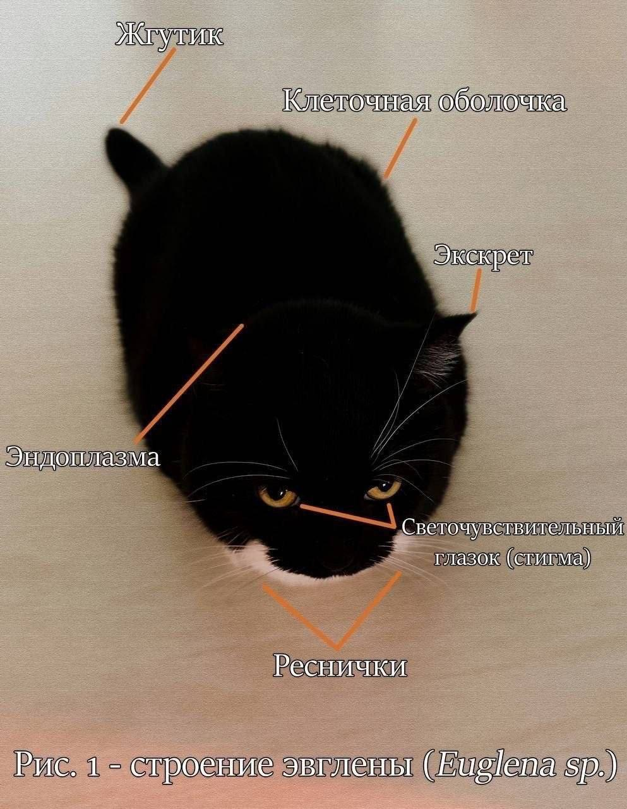

# Лабараторная работа №2.

Выполнил студент группы 6405-010302D
Поплевин Н.А.

## Страницы
- index.html — главная страница c краткой сводкой.
- history.html — страница с историей монет и жетов Артикугля.
- catalog.html — каталог монет и жетонов.
- full.html — страница с полным изображением монеты.

## Реализованные требования
- используются только HTML и CSS
- четыре страницы
- блочные и строчные элементы
- внутренние и межстраничные ссылки
- различные картинки
- таблица с различными видами выравниваний
- отдельный подключаемый файл style.css
- различные виды CSS-селекторов: селектор тэга, селектор класса, селектор псевдокласса и т.д.
- множество различных цветов на разных элементах

"Денег нет, но вы держитесь"
                        Д.А. Медведев

