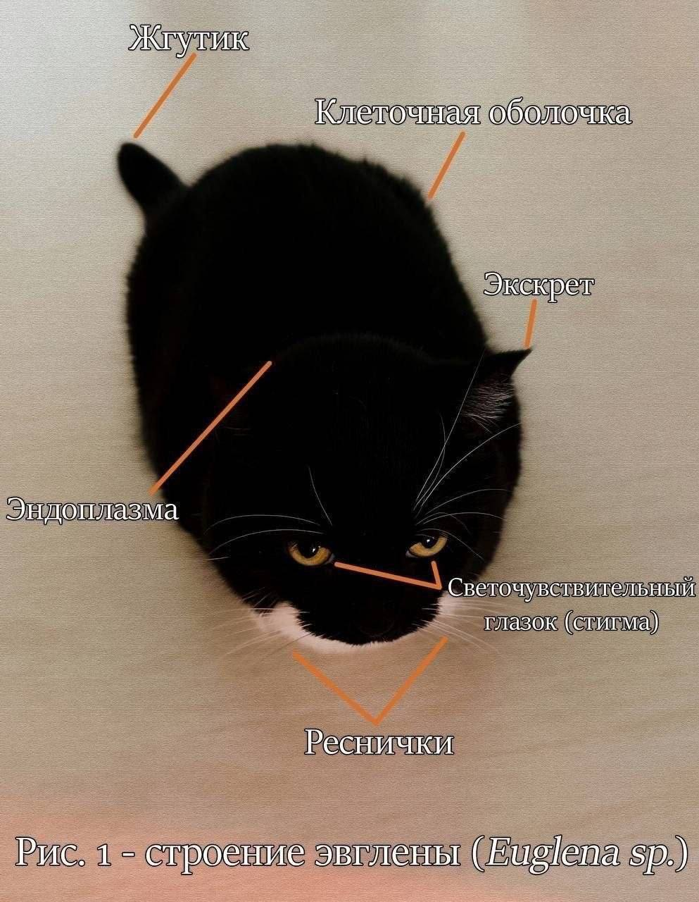

# Лабораторная работа №1.

Выполнил студент группы 6405-010302D Поплевин Н.А.

"Денег нет, но вы держитесь"
                        Д.А. Медведев

# Лабораторная работа №2.

Выполнил студент группы 6405-010302D
Поплевин Н.А.

## Страницы
- index.html — главная страница c краткой сводкой.
- history.html — страница с историей монет и жетов Артикугля.
- catalog.html — каталог монет и жетонов.
- full.html — страница с полным изображением монеты.

## Реализованные требования
- используются только HTML и CSS
- четыре страницы
- блочные и строчные элементы
- внутренние и межстраничные ссылки
- различные картинки
- таблица с различными видами выравниваний
- отдельный подключаемый файл style.css
- различные виды CSS-селекторов: селектор тэга, селектор класса, селектор псевдокласса и т.д.
- множество различных цветов на разных элементах

# Лабораторная работа №3.

Выполнил студент группы 6405-010302D
Поплевин Н.А.

## core.js

Реализация набора утилитных функций на JavaScript.

| Функция | Назначение |
|---|---|
| `isInteger(n)` | Проверка целого числа через побитовый оператор |
| `even()` | Массив чётных чисел от 2 до 20 |
| `sumTo(n)` | Сумма чисел от 1 до n (цикл) |
| `recSumTo(n)` | Сумма чисел от 1 до n (рекурсия) |
| `factorial(n)` | Факториал числа n |
| `isBinary(n)` | Проверка, что n — степень двойки |
| `fibonacci(n)` | N-е число Фибоначчи |
| `getOperationFn(initialValue, operatorFn)` | Функция-аккумулятор, применяющая операцию к сохранённому значению |
| `sequence(start, step)` | Генератор арифметической последовательности |
| `deepEqual(a, b)` | Рекурсивное сравнение значений и объектов (включая массивы, `NaN`, функции по ссылке) |

# Лабораторная работа №4.

Выполнил студент группы 6405-010302D
Поплевин Н.А.

## Страницы
- index.html — главная страница c краткой сводкой.
- history.html — страница с историей монет и жетов Артикугля.
- catalog.html — каталог монет и жетонов.
- full.html — страница с полным изображением монеты.
- form.html — страница с формой обратной связи.

## Реализованные требования
- Вёрстка с помощию Flexbox
- Вёрстка c помощью Grid
- Все цвета в переменных CSS
- Анимация на заглавной странице через CSS
- Страница с формой (form.html) с нексолькими типами полей
- form.js с классом, реализующим конструктор и метод вывода в консоль данных формы
- Все страницы переделаны в соответствие методологии БЭМ